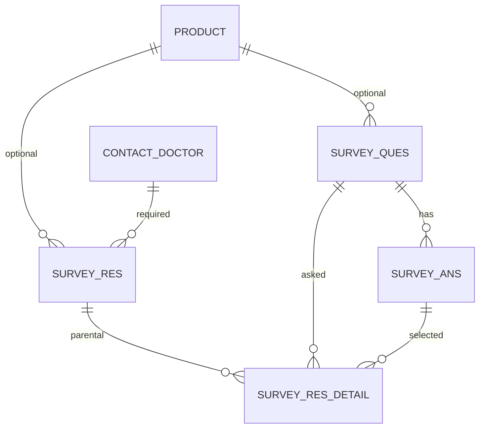

# Survey Form (PCF) – Sales CRM

A **Survey** tab for the existing Sales CRM app. A PCF (Power Apps Component Framework) control reads active questions and answers from Dataverse, shows them together on one page, and saves every selected answer to the response tables when the user clicks **Submit**. Admins add or change questions later with **no code change**.

> Last updated: Nov 5, 2026 · Owner: @Ornab

---

## Table of Contents

1. [Overview](#overview)
2. [Key Design Decisions](#key-design-decisions)
3. [Data Model](#data-model)
4. [Table Relationships](#table-relationships)
5. [User Guides](#user-guides)
6. [Survey Logic Rules](#survey-logic-rules)
7. [Power Apps Form Design](#power-apps-form-design)
8. [PCF Development Guide](#pcf-development-guide)
9. [Demo Data](#demo-data)
10. [Demo Scenarios](#demo-scenarios)
11. [Testing & Go-Live](#testing--go-live)
12. [Future Extensions](#future-extensions)

---

## Overview

Two user types share one survey engine:

| | BD user | Cambodian user |
|---|---|---|
| Selects Doctor | Yes | Yes |
| Selects Product | No | Yes |
| Questions shown | General questions (Product empty) | Questions of the selected product |
| Question types | Single, Multi or Open text (set per question) | Single, Multi or Open text (set per question) |
| Answer rule | Single: one answer. Multi: one or more. Open text: a typed reply | Same as BD |
| How it starts | Select doctor → **Start Survey** | Select doctor and product → **Start Survey** |

### Build order

1. Fix the data model, then create relationships.
2. Build the admin forms and load demo data.
3. Build the Survey Res main form with the Survey tab.
4. Develop and deploy the PCF control.
5. Test with the demo scenarios and go live.

---

## Key Design Decisions

- **Product drives the questions.** Every question has an optional Product. Empty = general question (shown when the response has no product). A product = shown only for that product.
- **Question Type per question.** `Single` (pick one), `Multi` (pick one or more) or `Open text` (type a reply). Works identically for BD and Cambodian users; a new question of any type needs no code change.
- **No Region or Business Unit rule.** The control only looks at the product on the response.
- **Two forms, one table.** *Survey BD* (no Product field) and *Survey Cambodia* (Product required) are two forms of Survey Res, assigned by security role.
- **Snapshots.** Each response stores a copy of the question and answer text, so old responses never change when an admin edits a question.
- **Read-only on setup data.** The PCF only reads questions and answers, and writes only to **Survey Res** and **Survey Res Detail**.

---

## Data Model

Four custom tables plus the system tables Contact (Doctor) and Product.

### Survey Ques (`btcl_surveyques`)

| Field | Verdict | Notes |
|---|---|---|
| `btcl_questiontext` | Keep | Primary name. Max length 500. |
| `btcl_questioncode` | Keep | Unique by rule (e.g. `Q-001`). Used in the response snapshot. |
| `btcl_questiontype` | **New** | Choice: Single, Multi, Open text. Default Single, required. |
| `btcl_product` | Keep | Optional. Empty = general question. |
| `btcl_region` | Not used | Remove from forms/views or delete the column. |
| `btcl_sequence` | Keep | Order of questions within a survey. |
| `btcl_isactive` | Keep | Default Yes. The PCF loads only active rows. |
| `btcl_surveyquestionid` | Remove/rename | Duplicate of the system primary key. Delete, or make it an Autonumber if a visible number is needed. |

### SurveyAns (`btcl_surveyans`)

| Field | Verdict | Notes |
|---|---|---|
| `btcl_answertext` | Keep | Primary name. |
| `btcl_answercode` | Keep | Used in the response snapshot. |
| `btcl_question` | Keep | Required lookup to Survey Ques. |
| `btcl_sequence` / `btcl_sortorder` | Duplicate | Keep only `btcl_sortorder`. |
| `btcl_surveyanswerid` | Remove/rename | Same duplicate-key issue as above. |
| `btcl_isactive` | **New** | Yes/No, default Yes. Hides an answer without deleting it. |

> **Rule:** Answers exist only for Single and Multi questions. Open text questions have no answer rows.

### Survey Res (`btcl_surveyres`)

| Field | Verdict | Notes |
|---|---|---|
| `btcl_name` | Keep | Primary name, set by a flow to the Response Reference. |
| `btcl_doctor` | Keep | Required lookup to Contact. |
| `btcl_product` | Keep | Optional. Required on *Survey Cambodia*; not shown on *Survey BD*. |
| `btcl_region` | Not used | Remove or delete. |
| `btcl_surveystatus` | Fix | Choice: Draft, In Progress, Completed, Cancelled. |
| `btcl_surveystarttime` / `btcl_surveyendtime` | Keep | Start set on **Start Survey**; end set automatically on **Submit**. |
| `btcl_responsereference` / `btcl_surveyresponseid` | Duplicate | Keep `btcl_responsereference` (e.g. `SR00001`). |
| `btcl_surveyui` | **New** | Single line of text; helper column that hosts the PCF control. |
| Owner (system) | Use | The sales person is the record owner. |

### Survey Res Detail (`btcl_surveyresdetail`)

| Field | Verdict | Notes |
|---|---|---|
| `btcl_response` | Keep | Lookup to Survey Res. **Parental** relationship. |
| `btcl_question`, `btcl_selectedanswer` | Keep | Lookups to Survey Ques / Survey Ans. Multi = one row per tick; Open text = Selected Answer empty. |
| `btcl_questioncode`, `btcl_answercode`, `btcl_answertext` | Keep | Snapshot fields. For Open text, `btcl_answertext` holds the typed text (raise max length to **2000**). |
| `btcl_questiontext` | **New** | Single line of text (500). Snapshot of the question wording. |
| `btcl_sortorder` | Keep | Copy of the question sequence at survey time. |
| `btcl_isrequired` | Keep | Copy of the required rule. |
| `btcl_isapplicable`, `btcl_dependsonquestioncode`, `btcl_dependsonanswercode` | Phase 2 | Only for conditional questions; leave empty for now. |
| `btcl_detailid` | Keep | Autonumber, reference only. |

### Other items

| Item | Why |
|---|---|
| Question ↔ Product many-to-many (optional) | Only if one question must appear under several products; otherwise duplicate the question per product. |
| Duplicate guard (PCF logic) | Dataverse can't enforce one answer per question per response through lookups, so the PCF removes rows from a failed attempt and rewrites them. |

---

## Table Relationships

| # | From (many) | Lookup column | To (one) | Delete behavior |
|---|---|---|---|---|
| 1 | Survey Ques | `btcl_product` | Product | Referential, restrict delete |
| 2 | SurveyAns | `btcl_question` | Survey Ques | Referential, restrict delete |
| 3 | Survey Res | `btcl_doctor` | Contact | Referential, restrict delete |
| 4 | Survey Res | `btcl_product` | Product | Referential, restrict delete |
| 5 | Survey Res Detail | `btcl_response` | Survey Res | **Parental** (deleting a response deletes its details) |
| 6 | Survey Res Detail | `btcl_question` | Survey Ques | Referential, restrict delete |
| 7 | Survey Res Detail | `btcl_selectedanswer` | Survey Ans | Referential, restrict delete |

Restrict delete protects history: once a question has responses it can't be deleted. Admins set **Is Active = No** instead.

---

## User Guides

One response = one doctor, one visit and (for Cambodia) one product.

### Admin (set up questions)

1. Open the Sales app → **Survey Setup** (links: Survey Questions, SurveyAnswers).
2. Create a question: Question Text, Question Code, Question Type, Product (only for product-specific questions), Sequence, Is Active = Yes.
3. For Single/Multi questions, add 2–3 answers in the Answers grid on the same form (Answer Text, Answer Code, Sort Order). Open text needs none.
4. To change wording, edit the text. To retire a question/answer, set Is Active = No. **Never delete** anything that already has responses.
5. To reorder, change Sequence (questions) or Sort Order (answers).

### BD sales person (no product)

1. Open **Survey Responses** → **New**.
2. Select the Doctor and save (no Product field on the Survey BD form).
3. Click **Start Survey** → Status = In Progress, Start Time saved.
4. Answer all general questions on one page by type.
5. Click **Submit Survey** → answers stored, Status = Completed, End Time filled automatically.

### Cambodian sales person (at the doctor's chamber)

1. Open **Survey Responses** → **New**, select the Doctor.
2. Select the Product and save. *Start Survey* stays disabled until a product is chosen.
3. Click **Start Survey** → all questions for that product appear on one page.
4. Answer every question. A counter shows progress; **Submit** stays disabled until all are answered.
5. Click **Submit Survey**. For another product at the same visit, create a new response.

### Edge cases the control handles

| Situation | What the user sees |
|---|---|
| No active question matches the selection | Message: no survey questions are set up for this selection. |
| Single/Multi question has no active answers | That question is left out. |
| Open text empty or only spaces | Counts as unanswered; Submit stays disabled. |
| Form closed before submitting | Unsubmitted selections are lost; Status stays In Progress. |
| Product changed after starting | Blocked; cancel and create a new response. |
| Submit fails (e.g. network loss) | Page keeps selections and typed text, shows an error. Re-submitting removes rows from the failed attempt and rewrites them (no duplicates). |

---

## Survey Logic Rules

The only thing that changes the questions is the product on the response.

| Step | Rule |
|---|---|
| 1. Read the response | Product filled → product-wise survey. Product empty → general survey. |
| 2. Start Survey | Doctor required (Product required only on the Survey Cambodia form). Sets Status = In Progress and Start Time = now. |
| 3. Load questions | Active questions filtered by product, sorted by Sequence, with their Question Type. |
| 4. Load answers | Single/Multi only: active answers sorted by Sort Order. |
| 5. Show and select | All questions on one page, each drawn by type. Nothing is written yet. |
| 6. Submit | Allowed only when every question is answered. Writes one detail row per Single/Open text question and one per ticked answer for Multi, each with snapshot fields. Rows from an earlier failed attempt are deleted first. |
| 7. Close the survey | After all rows are saved: Status = Completed, End Time = now. |

**Question filter**

- *General survey (no product):* active questions where Product is empty, ordered by Sequence.
- *Product-wise survey:* active questions where Product equals the selected product, ordered by Sequence.
- *Answer filter:* active answers for the question, ordered by Sort Order (Single/Multi only).

**Save rules for Survey Res Detail**

| Column | Value saved |
|---|---|
| `btcl_response` | The current Survey Res |
| `btcl_question` | The question shown |
| `btcl_selectedanswer` | Single: picked answer. Multi: one row per tick. Open text: empty |
| `btcl_questioncode`, `btcl_questiontext` | Copied from the question |
| `btcl_answercode` | Copied from the answer (empty for Open text) |
| `btcl_answertext` | Copied from the answer; for Open text, the typed text |
| `btcl_sortorder` | Copied from the question's Sequence |
| `btcl_isrequired` | True for every question in this version |
| `btcl_name` | Question code + answer code (question code only for Open text) |

> **Open decision:** Should a Cambodian user also see general questions that have no product? This plan says **no**. If yes, the product filter needs one extra condition: *or Product is empty*.

---

## Power Apps Form Design

Build in the solution that holds your tables: make.powerapps.com → Solutions → your solution → Tables.

### Survey Res main form (used by sales people)

Create two copies and assign by security role: **Survey BD** (no Product field) and **Survey Cambodia** (Product required).

| Area | Contents |
|---|---|
| Header | Response Reference, Survey Status, Owner (all read-only) |
| Tab 1 – Survey Details (Visit section) | Name, Doctor (required), Product (Cambodia form only), Start Time, End Time (read-only) |
| Tab 2 – Survey | One section, one column, full width, containing only the **Survey UI** field (label hidden). The PCF attaches here. |
| Tab 3 – Answers Summary | Read-only subgrid of Survey Res Detail filtered to the response: Question Text, Answer Text, Sort Order |

`btcl_name` needs a value: create a small Power Automate flow on Survey Res create that sets Name to the Response Reference.

### Survey Ques main form (admin)

Fields: Question Text, Question Code, Question Type, Sequence, Is Active, Product. Includes an editable **Answers** subgrid (view: Active Survey Answers) so admins add answers without leaving the question.

### SurveyAns main form (admin, simple)

Answer Text, Answer Code, Question, Sort Order, Is Active.

### Views

| Table | View | Columns |
|---|---|---|
| Survey Ques | Active Questions | Sequence, Question Code, Question Text, Question Type, Product |
| SurveyAns | Active Answers | Question, Sort Order, Answer Text |
| Survey Res | My Survey Responses | Response Reference, Doctor, Product, Survey Status, Start Time |
| Survey Res | Completed Responses | Response Reference, Doctor, Product, End Time, Owner |

### Sales app navigation

1. Edit the Sales app in the app designer.
2. Add group **Surveys** → Survey Responses (all sales people).
3. Add group **Survey Setup** → Survey Questions, SurveyAnswers (limited by security role to admins).
4. Save and Publish.

### Table ownership and security roles

| Table | Ownership | SurveyAdmin role | Sales person role |
|---|---|---|---|
| Survey Ques, SurveyAns | Organization | Create, Read, Write, Delete | Read only |
| Survey Res | User or team | Read (BU or Org) | Create, Read, Write at User level |
| Survey Res Detail | User or team | Read (BU or Org) | Create, Read, Write, **Delete** at User level (Delete cleans up a failed submit) |
| Contact, Product | System | Read | Read |

---

## PCF Development Guide

A plain (standard) PCF control, **no React**: one manifest file, one TypeScript file, one CSS file.

### Prerequisites

- Node.js LTS
- Visual Studio Code with the **Power Platform Tools** extension (installs the Power Platform CLI, `pac`)
- .NET SDK (later, for packaging the solution)

### Prepare Dataverse

Create these columns first:

| Table | Column | Type | Notes |
|---|---|---|---|
| Survey Ques | `btcl_questiontype` | Choice: Single, Multi, Open text | Default Single, required |
| Survey Res | `btcl_surveyui` | Single line of text | Hosts the control on the form |
| SurveyAns | `btcl_isactive` | Yes/No (default Yes) | Lets admins hide an answer |
| Survey Res Detail | `btcl_questiontext` | Single line of text (500) | Question snapshot |
| Survey Res Detail | `btcl_answertext` | Single line of text | Raise max length to 2000 |

Then note these environment-specific values; the code's configuration block must match them **exactly**:

1. **Choice values** for Survey Status (Draft, In Progress, Completed) and Question Type (Single, Multi, Open text).
2. **Entity set names** of Survey Res, Survey Ques and Survey Ans (from the Web API `EntityDefinitions` endpoint).
3. **Lookup navigation property names** (case-sensitive) for Response, Question and Selected Answer on Survey Res Detail.

### Project structure

| File / folder | Purpose | Your action |
|---|---|---|
| `ControlManifest.Input.xml` | Registers the control and its bound field | Replace content |
| `index.ts` | All logic and the screen | Replace content |
| `css/SurveyControl.css` | Styling | Create folder and file |
| `generated/` | Auto-made typings | Never edit |
| `package.json`, `tsconfig.json`, `SurveyControl.pcfproj` | Project settings | Leave as they are |
| `node_modules/` | Downloaded packages | Never edit |

### Control behavior (`index.ts`)

- **load** decides what to show (no record, Completed, In Progress, or start screen).
- **loadQuestions** applies the product filter, then loads answers for Single/Multi questions only.
- **render** draws all questions on one page by Question Type, with a progress counter and a Submit button that enables when everything is answered.
- **submit** deletes rows from any earlier failed attempt, writes the detail rows with snapshots, then sets Status = Completed and End Time.

### Build, publish and place on the form

1. Scaffold the project with `pac pcf init` (namespace `BTCL`, name `SurveyControl`, template `field`) and install packages with `npm install`.
2. Build with `npm run build`. The local test page can't reach Dataverse, so test inside the real app.
3. Authenticate with `pac auth create` and publish with `pac pcf push --publisher-prefix btcl`.
4. In Survey Res → Forms → *Survey Cambodia* (then *Survey BD*): open the Survey tab, select **Survey UI**, turn on **Hide label**, add the **Survey Control** component for Web, Tablet and Phone, make the section one column / full width, then Save and Publish.

### Package for production

Create a solution project with `pac solution init`, add a reference to the control with `pac solution add-reference`, and build in Release configuration. The zip appears in `bin\Release`; import it via **Solutions → Import solution**, then add the control to the forms in the target environment.

### Changing the code later

Edit the file, raise the manifest version (e.g. 1.0.0 → 1.0.1), run `pac pcf push` again, then hard-refresh the browser (Ctrl+F5).

### Troubleshooting

| Symptom | Likely cause / fix |
|---|---|
| Survey tab is blank | Control not added to the Survey UI field, or form not published. |
| "Save the response first" message | Record has no ID yet. Save the form. |
| Resource or segment not found | Entity set name in the config block is wrong. |
| Undeclared property / navigation property | Lookup link name misspelled or wrong case. |
| Start Survey disabled | Doctor not selected and saved. |
| "No survey questions are set up" | No active question matches the product (or no active general question for an empty product). |
| Wrong control for a question | Question Type numbers in the config don't match the column. Empty type is treated as Single. |
| Status doesn't change to Completed | Survey Status numbers in the config don't match the column. |
| Delete permission error on Submit | Sales person role needs Delete at User level on Survey Res Detail. |

---

## Demo Data

Enter in this order: Products → Doctors → Questions → Answers (via the Answers grid). Keep two test users (BD form and Cambodia form), both with the Sales person role.

**Products:** Demo Analgesic (Cambodia questions: 4), Demo Antacid (Cambodia questions: 2)

**Doctors:** Dr. Rahim Uddin (BD demo), Dr. Sokha Chan (Cambodia, Demo Analgesic), Dr. Dara Sok (Cambodia, Demo Antacid)

### Survey Ques (11 records)

| Code | Question Text | Type | Product | Seq |
|---|---|---|---|---|
| Q-BD-001 | How often do you prescribe our products? | Single | (empty) | 1 |
| Q-BD-002 | How would you rate the product quality? | Single | (empty) | 2 |
| Q-BD-003 | Would you like a follow-up visit? | Single | (empty) | 3 |
| Q-BD-004 | Which channels do you prefer for updates? | Multi | (empty) | 4 |
| Q-BD-005 | Any comments for our team? | Open text | (empty) | 5 |
| Q-KH-A001 | Do you currently prescribe Demo Analgesic? | Single | Demo Analgesic | 1 |
| Q-KH-A002 | What are your reasons for choosing it? (tick all that apply) | Multi | Demo Analgesic | 2 |
| Q-KH-A003 | Would you recommend it to colleagues? | Single | Demo Analgesic | 3 |
| Q-KH-A004 | Any other feedback on Demo Analgesic? | Open text | Demo Analgesic | 4 |
| Q-KH-B001 | How satisfied are patients with Demo Antacid? | Single | Demo Antacid | 1 |
| Q-KH-B002 | Do you need more product samples? | Single | Demo Antacid | 2 |

### SurveyAns (25 records; none for Open text)

| Question | Answers (code → text, sort order) |
|---|---|
| Q-BD-001 | A-001 Frequently (1), A-002 Sometimes (2), A-003 Rarely (3) |
| Q-BD-002 | A-001 Excellent (1), A-002 Good (2), A-003 Needs improvement (3) |
| Q-BD-003 | A-001 Yes (1), A-002 No (2) |
| Q-BD-004 | A-001 Visit (1), A-002 Phone (2), A-003 Email (3) |
| Q-KH-A001 | A-001 Yes, regularly (1), A-002 Occasionally (2), A-003 No (3) |
| Q-KH-A002 | A-001 Effectiveness (1), A-002 Price (2), A-003 Patient preference (3) |
| Q-KH-A003 | A-001 Yes (1), A-002 Maybe (2), A-003 No (3) |
| Q-KH-B001 | A-001 Very satisfied (1), A-002 Satisfied (2), A-003 Not satisfied (3) |
| Q-KH-B002 | A-001 Yes (1), A-002 No (2) |

### Expected result records

Don't type these by hand; create them by running the demo scenarios and compare.

**Survey Res**

| Reference | Doctor | Product | Status | Start | End |
|---|---|---|---|---|---|
| SR-00001 | Dr. Rahim Uddin | (empty) | Completed | 2026-11-03 10:05 | 2026-11-03 10:09 |
| SR-00002 | Dr. Sokha Chan | Demo Analgesic | In Progress | 2026-11-04 14:20 | (empty) |

**Survey Res Detail (SR-00001)**

| Question | Selected answer | Snapshot answer text |
|---|---|---|
| Q-BD-001 | A-001 | Frequently |
| Q-BD-002 | A-002 | Good |
| Q-BD-003 | A-001 | Yes |
| Q-BD-004 | A-001 | Visit |
| Q-BD-004 | A-003 | Email |
| Q-BD-005 | (empty, Open text) | Please send more samples |

---

## Demo Scenarios

Run in order after the control is deployed.

| Scenario | Setup | Expected result |
|---|---|---|
| **A – BD, no product** | BD user creates a response for Dr. Rahim Uddin (no Product field). Save → "Ready to start". Start Survey. | One page with 5 general questions (3 Single, 1 Multi, 1 Open text). Counter starts at 0 of 5. After answering (e.g. Frequently, Good, Yes; tick Visit and Email; type a comment), Submit enables. Submit → Completed, Start/End filled, **6 detail rows** (two ticks = two rows). |
| **B – Cambodia, Demo Analgesic** | Cambodia user selects Dr. Sokha Chan + Demo Analgesic, Save, Start Survey. | One page with **4** Demo Analgesic questions (Single, Multi, Single, Open text). After answering all, Submit → Completed with End Time. BD and Demo Antacid questions never appear. |
| **C – Cambodia, Demo Antacid** | Select Dr. Dara Sok + Demo Antacid, Save, Start Survey. | Only **2** questions, proving questions follow the product. |
| **D – Forgot product** | Cambodia user saves a response with a doctor and no product. | Survey tab asks for the product; Start Survey is disabled. |
| **E – Change answers** | Start a survey, change answers before Submit. | Single selection moves; Multi ticks toggle; text is editable. After Submit: one row per Single/Open text, one per Multi tick. A retried Submit after a network failure leaves no duplicates. |
| **F – Admin adds a question** | Admin adds a new general question (no product, next sequence, Is Active = Yes) with two answers. | Next BD survey shows the extra question. Set Is Active = No and it disappears. |

---

## Testing & Go-Live

### Work order

1. Decide open points: product sharing across questions, general questions for Cambodia.
2. Apply the table suggestions and add the new columns.
3. Create the relationships.
4. Build forms, views and sitemap.
5. Create security roles and test users (one BD, one Cambodia, one admin).
6. Enter the demo data.
7. Look up status values, entity set names and link names.
8. Create, build and push the PCF project.
9. Add the control to both Survey Res forms.
10. Run scenarios A–F.
11. Package the solution and import to the live environment.
12. Remove demo data and load the client's real questions and answers.

### Test cases to sign off

| # | Test | Pass condition |
|---|---|---|
| 1 | Response without a product shows only general questions | Scenario A |
| 2 | Response with a product shows only that product's questions | Scenarios B and C |
| 3 | Single, Multi and Open text work as designed | Single keeps one pick, Multi stores one row per tick, Open text stores the typed reply |
| 4 | Inactive question or answer is hidden | Scenario F |
| 5 | Sales person cannot edit questions or answers | Setup area hidden, edit refused |
| 6 | Sales person sees only their own responses | My Survey Responses shows own rows |
| 7 | Old responses unchanged after a question is edited | Detail snapshot keeps the old wording |
| 8 | Works on the mobile app | Run Scenario B on a phone |

### Data checks after the scenarios

| Check | Expected |
|---|---|
| Survey Res, Scenario A | Product empty, Completed, End Time after Start Time |
| Survey Res Detail, Scenario A | Exactly 6 rows: 3 Single, 2 Multi (Visit, Email), 1 Open text; no duplicates |
| Survey Res, Scenario B | Product = Demo Analgesic |
| Survey Res Detail, Scenario C | Exactly 2 rows |

### Go-live notes

- Import the **managed** solution, assign security roles and the Survey BD / Survey Cambodia forms, then add the real questions.
- Hand the client the User Guides section as a one-page guide for sales people and admins.
- Keep one admin owner for questions. Changes should be edits or Is Active = No, **never deletes**.

---

## Future Extensions

Not in this version:

- Conditional questions using the Depends On columns (show a question only after a chosen answer).
- Several products per question through a many-to-many relationship.
- Optional questions via an Is Required column on Survey Ques.
- More question types (e.g. rating scale, date) through the same Question Type column.
- A Power BI report on Survey Res and Survey Res Detail: answers per product and doctor.
